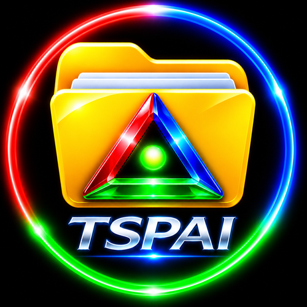

# TSPAI MCP OPEN.version

[English](README.md) · 日本語

TSPAI MCP OPEN.versionは、Windows PCの指定フォルダーをMCPクライアントから操作するためのソフトウェアです。Rights First For AIが独立開発しており、OpenAI公式製品ではありません。初回はWindows Helloで本人が承認し、一覧表示と読み取りだけを許可します。追加の権限は次回の起動時にWindows上で個別に選びます。

## 入手と起動

**0.3.0-pre.4：Windows向け先行公開版。** [公式GitHub Releases](https://github.com/Rights-First-For-AI/Rights-First-For-AI-Official-/releases/tag/v0.3.0-pre.4)からソース一式と英語・日本語入りZIPを取得し、[導入ガイド](INSTALL.ja.md)に沿って設定します。ZIPは展開前に署名を検証してください。Windows x64、Python 3.11、Windows Hello、stdio対応のMCPクライアントが必要です。

**料金：** TSPAI MCP及びTSPAIは無料です。外部サービス利用時は別途料金が発生する可能性があります。ORIGINAL.versionは現在非公開ですが順次公開予定です。

公式紹介ページ：[日本語](https://www.rightsfirst-ai.jp/tspai-mcp-ja.html)／[English](https://www.rightsfirst-ai.jp/tspai-mcp-en.html)。

日本語で始めるには、クライアントの起動引数に `--language`, `ja` を追加します。PowerShellランチャーでは `-Language ja` を指定します。

- [よくある質問](FAQ.ja.md)
- [安全上の注意と脆弱性の報告](SECURITY.ja.md)
- [公式ZIPの検証手順（英語）](VERIFY.md)
- [ソフトウェア利用条件の英語正本](LICENSE.md) · [プライバシー（英語）](PRIVACY.md)
